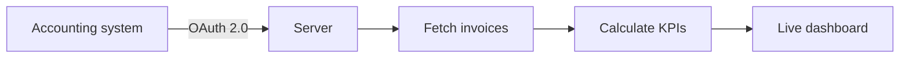
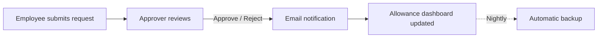
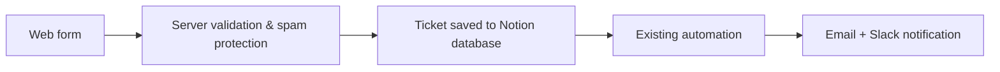
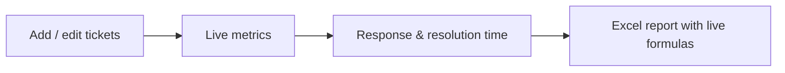
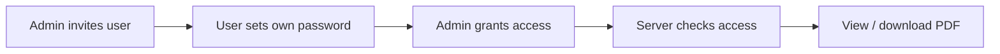

# Hi, I'm Fidan 👋

**Data Analyst & System Specialist** · Finance systems, dashboards and internal tools

> ⚠️ The projects below are shown as **overviews only**.
> The real source code is **private** because it contains confidential information.

---

## 📊 [Financial Dashboard](https://github.com/fidanberisha-png/financial-dashboard-overview)

**Why:** Give the finance team a real-time view of invoices and revenue, without manual exports from the accounting system.

**Tech:** JavaScript · Node.js · OAuth 2.0 · REST API

---

## 🗓️ [HR Leave Portal](https://github.com/fidanberisha-png/hr-leave-portal-overview)

**Why:** Replace leave and sick-leave requests sent by email or spreadsheet with one simple portal.

**Tech:** Next.js · Prisma · PostgreSQL · Nodemailer · GitHub Actions

---

## 🎫 [IT Ticket Portal](https://github.com/fidanberisha-png/it-ticket-portal-overview)

**Why:** Let colleagues open IT tickets from a simple web page, without needing an account in the ticketing workspace.

**Tech:** Node.js · Notion API

---

## 🛠️ [Support Ticket Tracker](https://github.com/fidanberisha-png/support-ticket-tracker-overview)

**Why:** Track support tickets opened with an external software vendor and measure how fast they respond and resolve them.

**Tech:** Node.js · HTML/CSS · Excel export

---

## 📁 [Document Access Portal](https://github.com/fidanberisha-png/document-access-portal-overview)

**Why:** Share confirmation PDFs securely, so each person only sees the documents they are allowed to see.

**Tech:** Node.js · Server-side sessions

---

**Tools I work with:** Business Central · Power BI · Tableau · Notion · JavaScript · SQL

---

### 🤖 How these projects were built

All projects were built through **vibe coding**. I came up with the ideas, wrote the prompts, defined the parameters and requirements, and tested each project until it worked correctly. The code itself was written with the help of AI (Claude).
